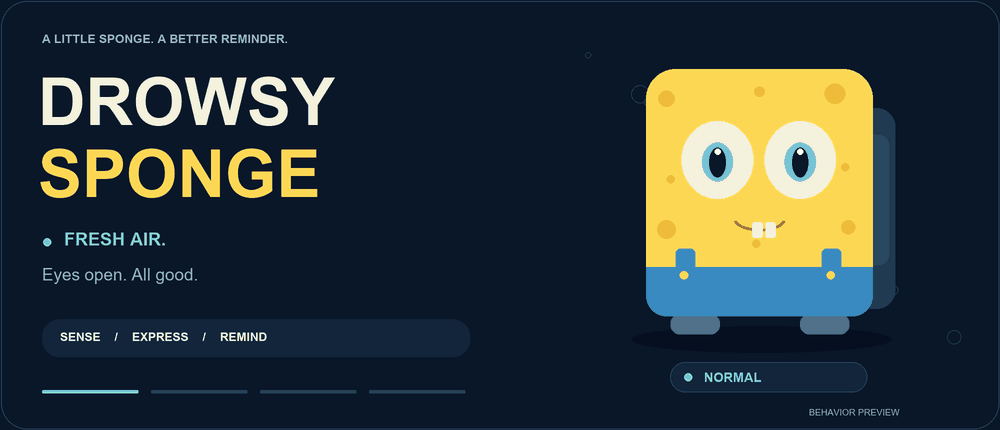
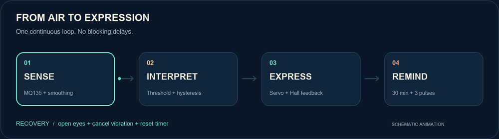
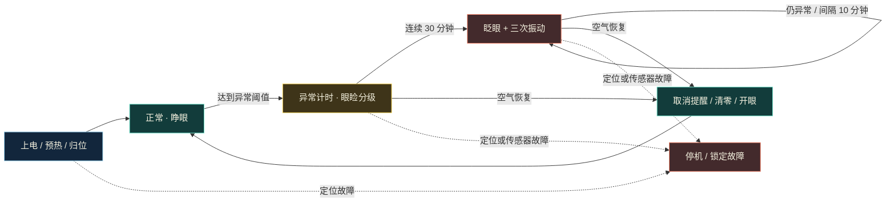
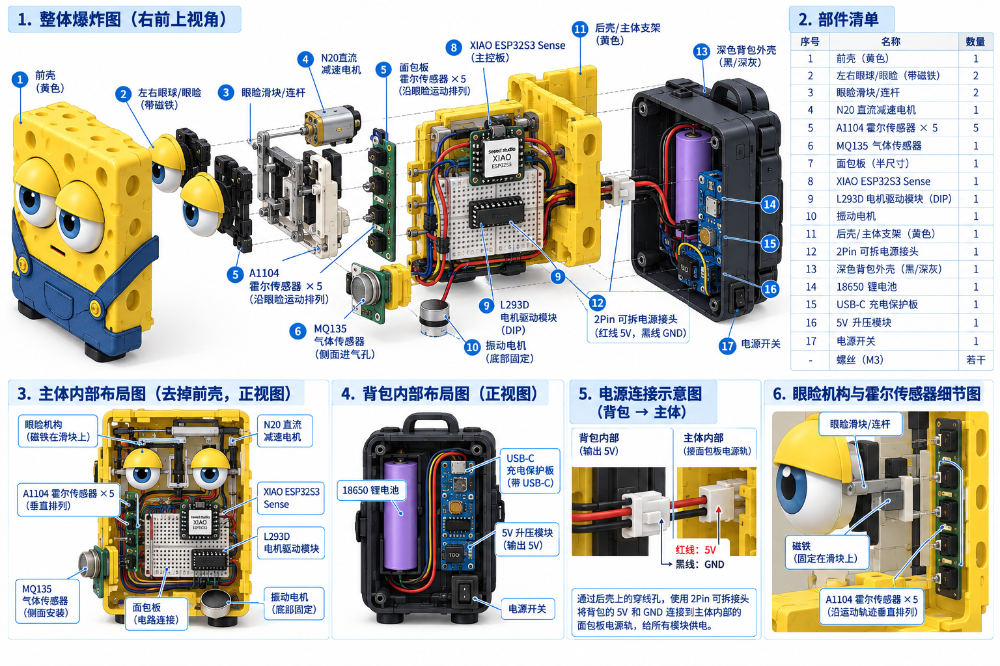
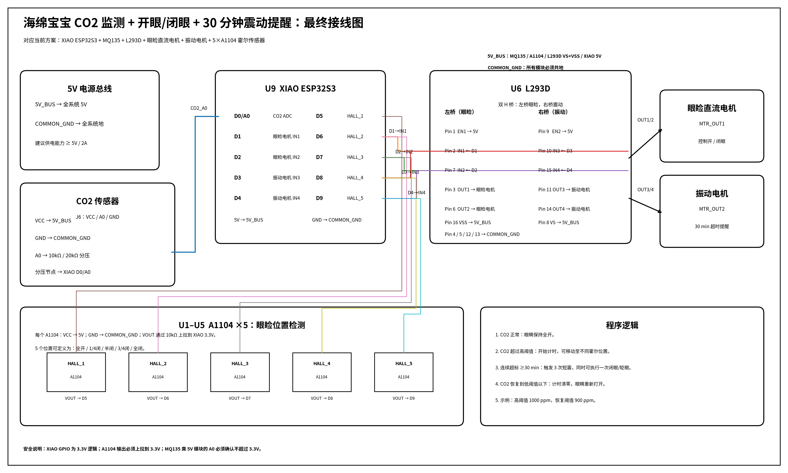

<div align="center">



# 把空气状态，变成一个表情。

一只会「犯困」的桌面海绵。用眼睑表达空气变化，用振动提醒你给房间透透气。

**SENSE THE AIR. EXPRESS THE CHANGE.**

[](https://github.com/sissixie777777/Spongebob/actions/workflows/firmware.yml)


[](LICENSE)

[看它如何工作](#02--从空气到表情) · [探索硬件](#03--外表是海绵里面是闭环控制) · [快速开始](#04--三步点亮它) · [技术文档](#05--从展示到复现)

<sub>原创示意动图，压缩演示完整交互流程；不是实机录像，也不代表实际传感器测量。</sub>

</div>

<br />


## 01 / 一个表情，就够了

它不需要你一直盯着数字。空气状态变化时，这个小家伙会慢慢变得困倦；异常持续足够久，它会闭眼、眨眼，再用三次振动提醒你。

| 🌿 空气良好 | 💤 空气变差 | 🔔 持续异常 | ✨ 恢复正常 |
| :---: | :---: | :---: | :---: |
| 眼睛睁开，安静陪伴 | 眼睑逐渐闭合 | **30 分钟**后眨眼 + 三次振动 | 重新睁眼，提醒计时清零 |
| 不需要一直盯着设备 | 三档位置反馈¹ | 每 **10 分钟**重复提醒 | 中途恢复也会取消剩余提醒 |

<sub>¹ 默认 Nano 版本有全开、半闭、全闭三个霍尔确认位置；XIAO 扩展版本支持五档。</sub>


## 02 / 从空气到表情



**感知 → 判断 → 表达 → 提醒。** 这条循环持续运行，眨眼和振动时也继续采样、检查位置与处理恢复。

| 环节 | 发生了什么 |
| --- | --- |
| **感知空气** | MQ135 每 100 ms 采样一次，经过平滑处理，降低读数抖动。 |
| **判断变化** | 通过高低阈值回差，减少临界值附近来回切换。 |
| **表达状态** | 舵机驱动眼睑，霍尔传感器确认真实机械位置。 |
| **发出提醒** | 连续异常达到 30 分钟，启动眨眼与三次 0.5 秒振动。 |
| **恢复复位** | 空气恢复时取消提醒、重新睁眼，并清零异常计时。 |

<details>
<summary><b>展开状态机，看看表情背后的逻辑</b></summary>



计时使用 `millis()` 的无符号差值，处理计数回绕。眼睑运动有 3 秒超时保护，目标变化不会反复延长动作预算。[阅读控制核心 →](firmware/controller.h)

</details>

> **关于读数：** MQ135 用于观察相对空气状态趋势，`air_index` **不是准确的 CO₂ ppm**。阈值和舵机角度需要按实物标定。[标定方法 →](docs/CALIBRATION.md)


## 03 / 外表是海绵，里面是闭环控制

黄色主体、蓝色背带裤、可移动的眼睑，以及背后的深色电池背包。外观负责表达，内部的传感器与驱动负责让动作发生。

<p align="center">
  
  <br />
  <sub>原仓库设计概念图，展示的是 XIAO / N20 / 五霍尔方案，非实物照片；默认 Nano / SG90 方案的器件与接线以当前说明为准。</sub>
</p>

| | 默认制作方案 | 原设计扩展方案 |
| --- | --- | --- |
| **主控** | Arduino Nano / ATmega328P | Seeed XIAO ESP32S3 |
| **眼睑驱动** | SG90 位置舵机 | N20 减速电机 + L293D |
| **位置反馈** | 3 × A1104 霍尔传感器 | 5 × A1104 霍尔传感器 |
| **提醒** | 带驱动三线振动模块 | L293D 第二路驱动振动电机 |
| **固件配置** | `nano` / `nano_demo` | `xiao` / `xiao_demo` |

**两套硬件，一套交互逻辑。** 默认配置按已购硬件实现，无显示屏；主体与背包之间仅连接 5V 与 GND。

[查看当前接线说明 →](docs/WIRING.md) · [阅读原始设计档案 →](docs/upstream/README.md)

<details>
<summary><b>查看原始 XIAO 电路概念图</b></summary>



此图保留原始设计。Nano 版本使用 SG90 和带驱动的振动模块，不能照图接成 N20 / L293D。XIAO 的 MQ135 分压修正也请以[当前接线说明](docs/WIRING.md)为准。

</details>


## 04 / 三步点亮它

安装 [PlatformIO](https://docs.platformio.org/en/latest/core/installation/index.html)，按[接线说明](docs/WIRING.md)连接硬件，在仓库根目录执行：

```bash
# 01 · 编译默认 Nano 固件
pio run -e nano

# 02 · 烧录，将 COM5 替换为实际端口
pio run -e nano -t upload --upload-port COM5

# 03 · 查看空气指标、位置和运行状态
pio device monitor --port COM5 --baud 115200
```

**先演示，再长测。** 将环境名换成 `nano_demo`，可使用 5 秒预热、30 秒触发、10 秒重报的演示时序。演示完成后切回 `nano`，恢复正式的 30 分钟提醒。Nano 新 bootloader 使用 `nano_new_bootloader`。

<details>
<summary><b>串口里能看到什么？</b></summary>

```text
state=NORMAL  raw=350  air_index=684  position=1  target=1  moving=0  fault=0
```

上面是说明字段的示例。`s` 输出状态，`r` 在检查机械机构后重试锁定故障。完整输出还包含时间、霍尔掩码、舵机角度与振动状态。故障码和当前机器的隔离工具用法见[固件手册](docs/FIRMWARE.md)。

</details>

## 05 / 从展示到复现

| 你想了解什么 | 从这里开始 |
| --- | --- |
| **怎么接线、两套硬件有何差异** | [接线说明](docs/WIRING.md) |
| **怎么设定角度、阈值和测试动作** | [标定与实机验收](docs/CALIBRATION.md) |
| **怎么构建、烧录和看故障码** | [完整固件手册](docs/FIRMWARE.md) |
| **设计要求如何落实到代码** | [要求对应表](docs/REQUIREMENTS.md) |
| **原来的机械、电源与外观设计** | [原始设计档案](docs/upstream/README.md) |
| **修改阈值、时序、舵机范围** | [配置文件](firmware/config.h) |
| **阅读控制器与测试** | [状态机](firmware/controller.h) · [自动化测试](tests/controller_test.cpp) |

### 表情背后，也有工程细节

- **真实位置反馈**：到达霍尔目标再停机，避免只凭运行时间猜位置。
- **持续响应**：归位、眨眼、振动、采样和计时协同运行，无阻塞等待。
- **故障停机**：运动超时、霍尔冲突、运动顺序反向及预热后持续 ADC 边缘值都会锁定故障。
- **可复现验证**：五套固件配置已在本地编译通过；控制核心通过时序、回绕、定位和恢复等自动化测试。远程结果见顶部 CI 徽章。

<details>
<summary><b>目录结构与动画再生成</b></summary>

```text
Spongebob/
├── assets/                  # 原创 GIF、静态预览与 SVG 装饰
├── firmware/                # 控制核心、引脚适配与配置
├── tests/                   # 控制逻辑自动化测试
├── tools/                   # 构建、测试与展示素材生成脚本
├── docs/                    # 接线、标定、固件和设计档案
└── .github/workflows/       # 五套配置构建 + 控制逻辑检查
```

动图可通过 `python tools/build_readme_assets.py` 重建，需要 Pillow 和 Arial / DejaVu Sans 字体。纯展示资源不参与固件构建；[素材说明](assets/README.md)记录了来源与动画含义。采购表仅在本地保留，不随公开仓库上传。

</details>

<br />

<div align="center">


**让房间透透气，也让小海绵醒一醒。**

<sub>课程创客项目 · 外观表达 × 传感交互 × 嵌入式控制</sub>

<sub>设计来源：[Spongebob](https://github.com/sissixie777777/Spongebob) · 灵感来源：[Spongebob That Can Detect Drowsiness](https://www.hackster.io/mondal3011/spongebob-that-can-detect-drowsiness-c610b4) · [MIT License](LICENSE)</sub>

</div>
